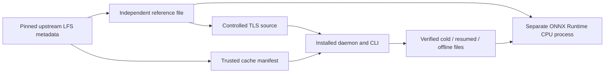

# Real-model demonstration

The prior `b3597f7` record is preserved as [JSON](../evidence/model-demo-before-closeout.json)
and [HTML](../evidence/model-demo-before-closeout.html). The current runner uses
the expanded 74-test cohort after the generation-retirement correction; use the
recorded revision when reproducing historical evidence.


This milestone exercises the installed Cacheweft daemon and CLI with a real
pre-trained SqueezeNet 1.1 ONNX model, instead of only deterministic test payloads.
It demonstrates verified transport, explicit continuation, offline availability
and model execution. It does not measure image-classification accuracy, train a
model, introduce an inference engine into the cache or qualify long-term service.

## Trust and licensing

The checked-in [trust lock](../examples/model.json) fixes ONNX Model Zoo commit
`c5cae0f1942c8d7727372c7b1f6b485aa39e4421`, artifact path, exact size
**4,956,208 bytes**, and SHA-256
`1eeff551a67ae8d565ca33b572fc4b66e3ef357b0eb2863bb9ff47a918cc4088`.
These values come from the pinned upstream Git LFS pointer, not from accepting
whatever a downloaded file hashes to. `examples.prepare` first checks that
pointer against the lock, retrieves the pinned license/model card, then downloads
an independent reference with bounded response length and no redirect/proxy.
The payload must match before it can serve as a reference.

- [Pinned upstream LFS pointer](https://github.com/onnx/models/blob/c5cae0f1942c8d7727372c7b1f6b485aa39e4421/validated/vision/classification/squeezenet/model/squeezenet1.1-7.onnx)
- [Pinned model card](https://github.com/onnx/models/blob/c5cae0f1942c8d7727372c7b1f6b485aa39e4421/validated/vision/classification/squeezenet/README.md)
- [Pinned Apache-2.0 license](https://github.com/onnx/models/blob/c5cae0f1942c8d7727372c7b1f6b485aa39e4421/LICENSE)

Upstream identifies this model as Apache-2.0 and trained on ImageNet. Neither
model weights nor ImageNet images are committed or packaged here. The demo uses
our deterministic synthetic RGB gradient, with the card's normalization, so
there is no downloaded image dataset or accuracy claim. The code never trains
or selects a model using evaluation inputs. Hash checking provides integrity
relative to trusted metadata, not independent publisher authentication or proof
that a model is safe. Upstream TLS/repository identity remain trust assumptions.
If redistributing weights elsewhere, preserve the upstream license/notices;
this repository does not grant a new license to those weights.

**Cacheweft itself still has no selected license.** Optional NumPy/ONNX Runtime
and their pinned dependencies are external tools with their own terms; they
are not vendored and are not added to the product wheel/runtime requirements.

## What is executed



The native macOS run also downloads directly from the pinned GitHub media URL
through the formal daemon/CLI, using a numeric address provisioned by DNS before
startup. The product still has no DNS fallback, redirects or proxy routing. It
is one real Internet observation, kept separate from controlled loopback TLS
cases. The independent reference bootstrap is not included in cache timing.

Each platform's controlled cases are:

1. **Empty cache:** one real TLS model fetch; formal CLI reads exact verified bytes.
2. **Interrupted continuation:** the source sends 262,144 bytes and stalls. After
   the formal checkpoint reaches that offset, SIGKILL terminates the actual
   daemon. Retained SQLite rows must still be WAITING with the old deadline.
   The new instance must report INTERRUPTED without an automatic GET, reject
   the old epoch, and require a new explicit resume request. The resumed request
   must send `Range: bytes=262144-` with the strong `If-Range` ETag, receive 206,
   and fetch only the remaining **4,694,064 bytes**. The two successful body-write
   counts together must equal one model's size; the old deadline is not extended.
   The original six-attempt budget is retained, not reset by restart/resume.
3. **Offline cache:** stop the source, verify connection refusal, restart the cold
   cache, then fetch/read from READY. Formal transfer-attempt and accepted-byte
   counters must remain unchanged. Linux additionally attaches real `strace`
   to the daemon and its threads before fetch through read and requires zero
   `connect` syscalls in that window. macOS does not claim syscall tracing.
4. **Wrong bytes:** a separate real TLS source alters one byte while advertising
   the same size/ETag. A one-attempt fixture must end FAILED, publish nothing,
   report unavailable and reject CLI read without creating an output file. The
   record must also show the complete advertised byte count received and a
   staging SHA-256 matching the deliberately altered model. A network failure
   before receiving the body cannot pass this integrity test.

The reference and three successful controlled outputs are loaded independently
by ONNX Runtime 1.31.0 CPUExecutionProvider, with NumPy 1.26.4, one intra/inter-op
thread and the identical hashed input. Each file gets a session, one warmup and
five measured inference calls. Shapes/finite output and allclose (rtol 1e-5,
atol 1e-6) are checked against the independently downloaded reference. The
record also carries output digests and maximum absolute errors; the verifier
requires identical output digests within each platform in this run. It does not
require floating-point digests to agree across different platforms.

The actual fixed model has input `[1,3,224,224]` and output **`[1,1000]`**. The
older upstream card shows `[1,1000,1,1]`; this demo follows the inspected model,
not that outdated shape. Outputs are model scores, not measured probabilities
or an assertion that a synthetic gradient has a meaningful ImageNet label.

## Reproduce

Prerequisites: Python 3.12+, a setuptools build environment, OpenSSL CLI, and
Colima/Lima for the separate disposable Linux VM. Run as an ordinary host user.
Paths below are examples; use fresh output/profile names on reruns.

```sh
python3.12 -m venv .venv
.venv/bin/pip install 'setuptools>=77' wheel
.venv/bin/python -m pip wheel --no-build-isolation --no-deps . --wheel-dir results/model-build
python3.12 -m venv .runtime-demo-venv
.runtime-demo-venv/bin/pip install --no-index --no-deps results/model-build/cacheweft-0.0.1-py3-none-any.whl
python3.12 -m venv .demo-venv
.demo-venv/bin/pip install --only-binary=:all: -r examples/requirements.txt
.venv/bin/python -m examples.prepare --output results/model-reference
.venv/bin/python -m examples.validate \
  --colima-home /absolute/colima-home \
  --toolchain /absolute/colima-bin-directory \
  --profile cw-exp-model-fresh \
  --wheel results/model-build/cacheweft-0.0.1-py3-none-any.whl \
  --reference results/model-reference/reference.onnx \
  --provenance results/model-reference/provenance.json \
  --runtime-cli .runtime-demo-venv/bin/cacheweft \
  --inference-python .demo-venv/bin/python \
  --output results/model-fresh
```

The runtime and inference interpreters must remain separate. Do not resolve the
Python venv executable's symlink to its base interpreter: that loses the venv.
The runner verifies wheel/runtime/source hashes, checks the runtime interpreter
cannot import NumPy or ONNX Runtime, runs the same 74 identified tests
on both platforms, then runs the real-model cases. Linux runtime source is moved
out of import reach after wheel installation. The guest installs the optional
inference requirements into a second venv and the observer attaches strace.
The formal Linux daemon runs UID/GID 65534, no capabilities and NoNewPrivs via
setpriv; root is used only for disposable-guest setup and observation. This
milestone does not rerun the systemd unit; its prior evidence remains separate.
The new VM has no host mounts and is deleted with its data disk after the run.
Model daemon and inference children remain in the observer process group so an
outer timeout can terminate the experiment together; normal paths explicitly
wait for each daemon and check socket/readiness cleanup. RSS records carry the
observed daemon PID, unprivileged UID and matching process-group identifiers.

## Measurement boundaries

"Cold" means an empty Cacheweft root/catalog, not flushed OS page caches. The
source body is already in the observer's memory. Reported fetch time includes
CLI process startup, admission and status polling. Read time includes CLI
startup, transfer to a separate output file and its fsync. Resumed fetch time
starts at the new resume call and excludes the first prefix, crash/restart and
operator delay; it must **not** be divided into cold time to claim a speedup.

Server byte counts measure successful application body writes, excluding
HTTP/TLS framing; they are not packet captures or total wire traffic. The
controlled interrupted source stops after an exact prefix, avoiding uncertain
partial send accounting. The real Internet run has no server-side counter and
must not be presented as measuring its wire bytes or WAN speedup.

RSS is sampled from the real daemon PID approximately every 50 ms (Linux procfs,
macOS ps); sampled maxima can miss short peaks. Observer/model-source memory,
reference copies and independent inference-process memory are excluded. The
inference subprocess starts after the measured daemons stop. Native macOS and
Linux VM samples are separately labeled, with no claim of hardware equivalence.
Disk observations cover regular-file unique-inode logical size and allocated
blocks inside each cache root, including catalog/metadata. Reference files,
CLI read outputs and Python environments are outside that scope. Payload
admission remains logical budgeting, not a physical filesystem quota.

This is a small fixed batch-one model and a short functional demonstration.
There is no accuracy evaluation, large-model scalability claim, WAN latency
percentile, long-term resource-growth result, automatic history rollover,
power-loss recovery, or boot-zero-gap qualification.

## Recorded result

The current [JSON](../evidence/model-demo.json) and [HTML](../evidence/model-demo.html)
revalidate the model workflows with exactly the same corrected runtime modules
and wheel SHA-256 as the bounded closeout. The earlier b3597f7 record is archived
above; its timings are not mixed into this run.

Both platforms passed **74 identified unit tests** and four controlled model
integration cases; native macOS also ran one separate Internet fetch. All
16 stages finished with exit 0/no timeout. The verifier rejected
24 corrupted copies; normal and optimized Python checks pass.

| Environment | Mode | Fetch phase seconds | CLI read seconds | Sampled max daemon RSS bytes | Cache-root logical bytes |
|---|---|---:|---:|---:|---:|
| Native macOS | cold | 0.163 | 0.051 | 30179328 | 4989063 |
| Native macOS | resumed | 0.140 | 0.051 | 30277632 | 4989063 |
| Native macOS | offline | 0.066 | 0.065 | 29130752 | 4989063 |
| Linux VM | cold | 0.159 | 0.033 | 25272320 | 4989062 |
| Linux VM | resumed | 0.134 | 0.033 | 25432064 | 4989062 |
| Linux VM | offline | 0.044 | 0.044 | 24678400 | 4989062 |

Resumed time excludes the prefix, crash and restart; no speedup ratio is derived.
All successful outputs match the locked model SHA-256. Their inference output
digests match the independent reference within each platform, with maximum
absolute error 0. Cross-platform bit equality is not required. Linux offline
fetch/read had an attached tracer and zero connect syscalls; native macOS
claims source refusal and unchanged transfer counters, without syscall tracing.
The corrupted case fully received the altered body, matched its known different
staging SHA-256 and refused publication/read.

The separate Internet fetch took 1.093 seconds, plus
0.084 seconds for CLI read. It is one CDN/address observation, not a WAN
speedup, percentile or bound. Daemon RSS excludes the inference process and
Linux VM samples remain separate from native macOS. All temporary model work,
the dedicated VM and its data disk were cleaned; preexisting profiles were unchanged.

Development checks caught the upstream card's outdated output shape, an
insufficient one-attempt fixture and venv symlink resolution losing its environment.
The original model milestone added no runtime dependencies; the closeout core
retirement correction is explicitly included and revalidated in this record.
